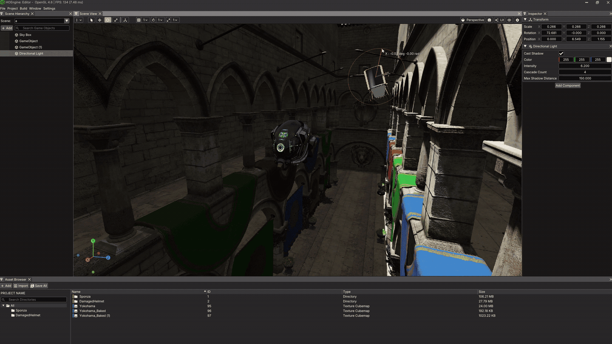
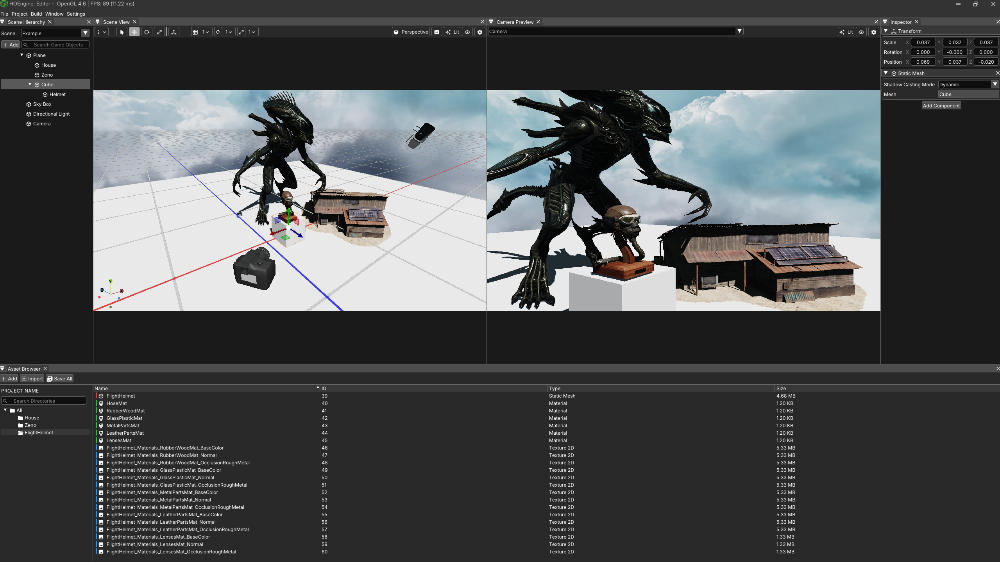
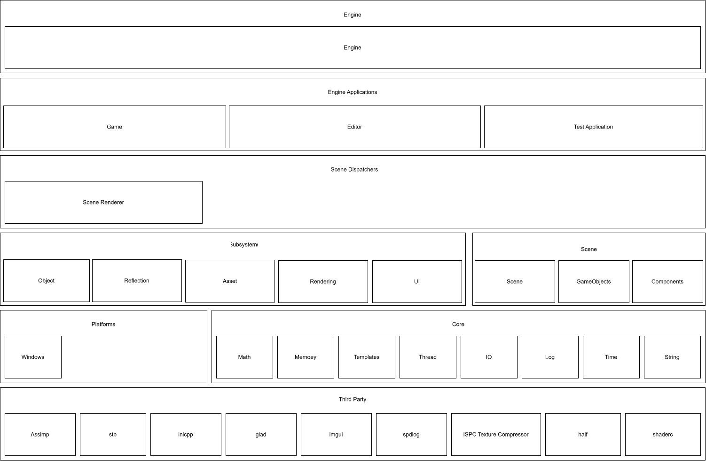
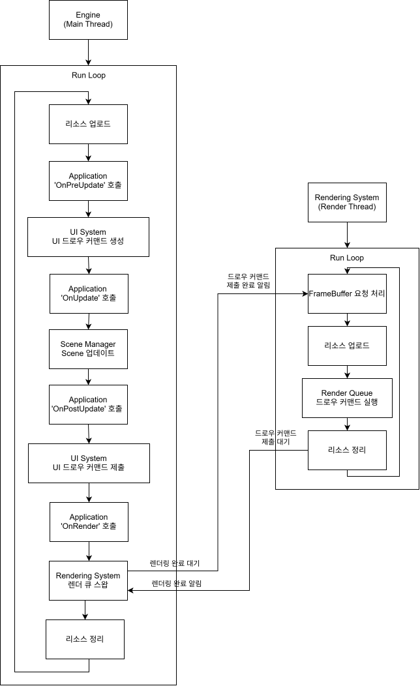

<p align="right">
  <a href="README.en.md">English</a> | <a href="README.kr.md"><b>한국어</b></a>
</p>

# 프로젝트 개요
본 프로젝트는 C++17을 기반으로 개발한 3D 게임 엔진입니다.
엔진의 주요 시스템과 렌더링 파이프라인을 직접 설계하고 구현하는 것을 목표로 개발하고 있습니다.


# 스크린샷
<p align="center">
  
</p>
<p align="center">
  
</p>

# 빌드 환경 및 방법

### 🛠️ 빌드 환경
- OS: Windows 10 / 11
- Compiler:
  - MSVC (`cl`)
  - Clang (`clang`, `clang++`)
- CMake: 3.23 이상
- C++ Standard: C++17

---

### 📦 빌드 파일 생성
- MSVC (Visual Studio 2022)
```
cmake -S . -B <디렉토리 이름> -G "Visual Studio 17 2022"
```
- Clang + Ninja (Debug)
```
cmake -S . -B <디렉토리 이름> -G Ninja -DCMAKE_C_COMPILER=clang -DCMAKE_CXX_COMPILER=clang++ -DCMAKE_BUILD_TYPE=Debug
```
- Clang + Ninja (Release)
```
cmake -S . -B <디렉토리 이름> -G Ninja -DCMAKE_C_COMPILER=clang -DCMAKE_CXX_COMPILER=clang++ -DCMAKE_BUILD_TYPE=Release
```

---

### 🔧 빌드
- MSVC (Debug)
```
cmake --build <디렉토리 이름> --config Debug
```
- MSVC (Release)
```
cmake --build <디렉토리 이름> --config Release
```
- Clang + Ninja (Debug/Release)
```
cmake --build <디렉토리 이름>
```

# 엔진 구조
<p align="center">
  
</p>

# 엔진 실행 흐름
엔진은 Application이 실행 과정에서 필요한 작업을 커맨드 형태로 Subsystem에 제출하고, Subsystem이 제출된 커맨드를 처리하는 방식으로 동작합니다.
이때 Application과 Subsystem의 실행 흐름은 중앙(Engine 클래스)에서 관리되어 Application의 실행 흐름과 각 Subsystem의 작업 수행 시점 및 순서는 오직 Engine에 의해 통제됩니다.
이는 Application 실행 중 Subsystem의 작업이 직접 수행되면서 발생할 수 있는 Subsystem 간 작업 의존성 문제를 방지하고, 작업 실행 순서를 일관되게 관리할 수 있도록 하기 위함입니다.

다이어그램으로 나타낸 엔진의 실행 흐름은 다음과 같습니다.

<p align="center">
  
</p>

# 기능
주요 모듈별 현재 구현된 기능은 다음과 같습니다.

| Name | Type |
|---|---|
| **Reflection System** | Built-in Type, Enum, Struct, Class에 대한 Reflection 정보 등록 및 조회<br>타입의 Name, Size, Alignment, Enum Entry, Property, Method 및 상속 관계 관리<br>Property별 Widget Type 메타데이터를 통한 Editor UI 표시 방식 지정<br>정적 등록 매크로를 통한 Reflection 정보 등록 |
| **Object System** | Object의 생성 및 소멸 관리<br>Object Pooling 기반 메모리 관리<br>상속 관계 기반 Object 순회<br>ObjectHandle을 통한 Dangling Pointer 방지 및 안전한 Type Casting<br>Object Manager를 통한 Object Pool 관리 |
| **Asset System** | Asset의 생성, 등록, 검색 및 소멸 관리<br>Static Mesh, Morph Target, Morph Animation, Material, Texture, Shader Asset 지원<br>Model Import 및 Asset Import Workflow 지원<br>Asset 간 참조 관계 관리 및 GPU Resource Upload 상태 관리 |
| **Rendering System** | **Rendering Infrastructure**<br>Render Pass 및 Render Stage 기반 렌더링 파이프라인 구성<br>Render Queue Double Buffering 및 별도 Rendering Thread를 통한 렌더링 작업 처리<br>Rendering Backend 추상화 및 GPU Resource 관리<br><br>**Rendering Pipeline**<br>Forward Rendering 기반 렌더링 파이프라인<br>PBR(GGX 기반 BRDF) 및 Phong Shading 지원<br>Opaque, Masked, Blended 등 Material Alpha Mode에 따른 렌더링 처리<br>Instanced Rendering을 통한 Draw Command 처리<br><br>**Shadow Mapping**<br>Directional, Point, Spot Light의 Dynamic Shadow Mapping<br>Point, Spot Light의 Static Shadow Map Baking 및 런타임 적용<br>Directional Light를 위한 Cascaded Shadow Mapping(CSM)<br><br>**Image Based Lighting**<br>Irradiance Map Baking<br>Prefiltered Environment Map Baking<br>BRDF Integration Map을 활용한 Image Based Lighting<br><br>**Post Processing**<br>ACES Filmic Tone Mapping<br>Gamma Correction |
| **Scene Manager** | Scene 및 GameObject, Component의 생성, 소멸 생명주기 관리<br>Component 기반 GameObject 구성 및 관리<br>Scene 및 Object의 Update, Garbage Collection 관리<br><br>Transform Component: Object Transform 및 Hierarchy 관리<br>Camera Component: Perspective, Orthographic Projection 지원<br>Static Mesh Component: Static Mesh 및 Shadow Casting Mode 설정<br>SkyBox Component: Sky Map, Irradiance Map, Prefiltered Environment Map 설정<br>Directional Light Component: Cascade 설정 및 Shadow Mapping<br>Point Light Component: Attenuation 및 Shadow Mapping<br>Spot Light Component: Cutoff, Attenuation 및 Shadow Mapping |
|**Editor**| **Main Window**: 	에디터의 메인 윈도우 및 메뉴 구성<br>**Scene Hierarchy Window**: Scene에 포함된 GameObject의 계층 구조 조회 및 관리<br>**Inspector Window**: 선택한 GameObject와 Component의 속성 조회 및 편집<br>**Scene View Window**: 현재 Scene의 렌더링 결과 확인 및 편집 도구 제공<br>**Asset Browser**: 엔진 에셋 탐색 및 관리<br>**Camera Preview	Window**: Scene에 존재하는 Camera의 렌더링 결과 확인<br>**Console Window**: 엔진 및 에디터에서 발생한 로그 확인|
# Reference
