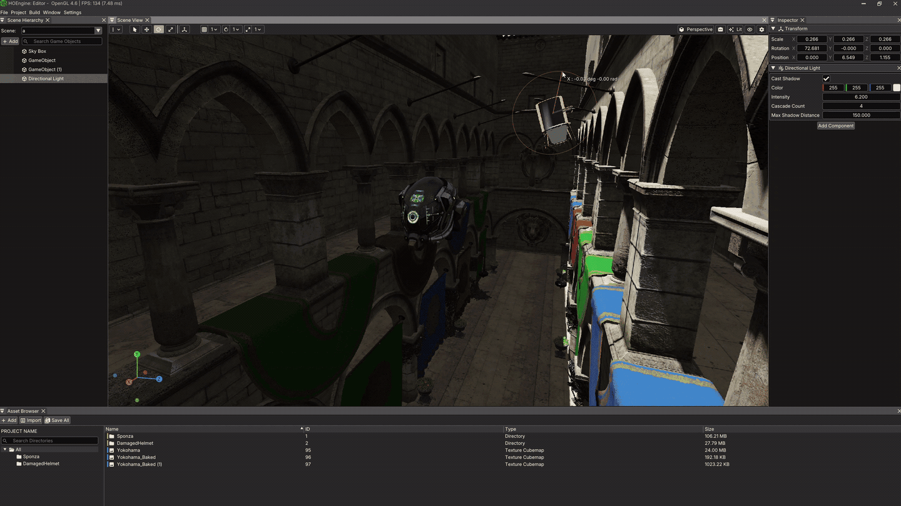
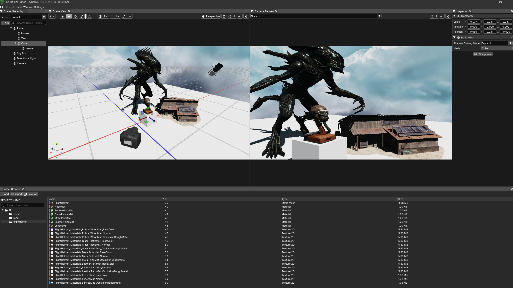
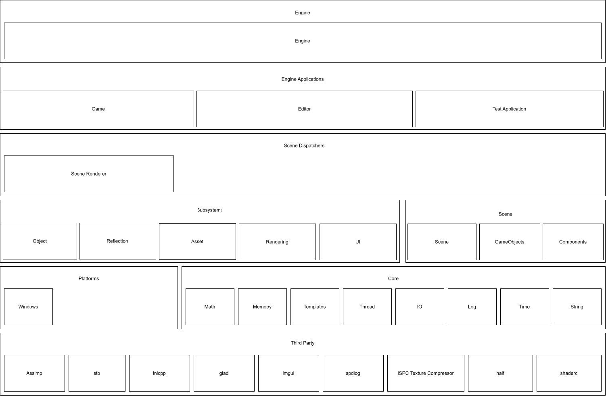
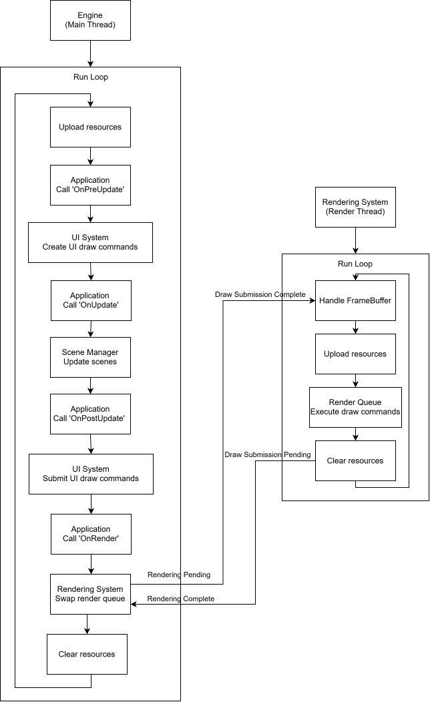

<p align="right">
  <a href="README.md"><b>English</b></a> | <a href="README.kr.md">한국어</a>
</p>

# Project Overview

This project is a 3D game engine developed using C++17.

The goal of this project is to design and implement the engine's core systems and rendering pipeline from the ground up.


# Screenshots

<p align="center">
  
</p>
<p align="center">
  
</p>

# Build Environment and Instructions

### 🛠️ Build Environment

- OS: Windows 10 / 11
- Compiler:
  - MSVC (`cl`)
  - Clang (`clang`, `clang++`)
- CMake: 3.23 or later
- C++ Standard: C++17

---

### 📦 Generate Build Files

- MSVC (Visual Studio 2022)
```bash
cmake -S . -B <build_directory> -G "Visual Studio 17 2022"
```

- Clang + Ninja (Debug)
```bash
cmake -S . -B <build_directory> -G Ninja -DCMAKE_C_COMPILER=clang -DCMAKE_CXX_COMPILER=clang++ -DCMAKE_BUILD_TYPE=Debug
```

- Clang + Ninja (Release)
```bash
cmake -S . -B <build_directory> -G Ninja -DCMAKE_C_COMPILER=clang -DCMAKE_CXX_COMPILER=clang++ -DCMAKE_BUILD_TYPE=Release
```

---

### 🔧 Build

- MSVC (Debug)
```bash
cmake --build <build_directory> --config Debug
```

- MSVC (Release)
```bash
cmake --build <build_directory> --config Release
```

- Clang + Ninja (Debug/Release)
```bash
cmake --build <build_directory>
```

# Engine Architecture

<p align="center">
  
</p>

# Engine Execution Flow

The engine operates by having the Application submit commands to Subsystems for tasks required during execution. Each Subsystem processes the commands submitted to it.

The execution flow of the Application and Subsystems is centrally managed by the Engine class. The Engine exclusively controls the execution flow of the Application, as well as the timing and order in which each Subsystem processes its tasks.

This approach prevents dependency issues between Subsystems that could arise if their tasks were executed directly during Application execution, while ensuring consistent control over task execution order.

The engine's execution flow is illustrated below.

<p align="center">
  
</p>

# Features

The following table summarizes the currently implemented features of each major module.

| Name | Features |
|---|---|
| **Reflection System** | Registration and retrieval of Reflection metadata for built-in types, enums, structs, and classes<br>Management of type names, sizes, alignments, enum entries, properties, methods, and inheritance relationships<br>Specification of Editor UI presentation through per-property Widget Type metadata<br>Registration of Reflection metadata through static registration macros |
| **Object System** | Object creation and destruction management<br>Memory management through memory pooling<br>Object iteration based on inheritance relationships<br>Prevention of dangling pointers and safe type casting through ObjectHandle |
| **Asset System** | Asset creation, registration, lookup, and destruction management<br>Support for Static Mesh, Morph Target, Morph Animation, Material, Texture, and Shader assets<br>Model Import and Asset Import workflows |
| **Rendering System** | **Rendering Infrastructure**<br>Rendering task execution on a dedicated rendering thread<br>PBR shading using a GGX-based BRDF and Phong shading<br><br>**Shadow Mapping**<br>Dynamic shadow mapping for Directional, Point, and Spot Lights<br>Static shadow map baking and runtime application for Point and Spot Lights<br>Cascaded Shadow Mapping (CSM) for Directional Lights<br><br>**Image-Based Lighting**<br>Irradiance Map baking<br>Prefiltered Environment Map baking<br>Image-Based Lighting using Irradiance, Prefiltered Environment, and BRDF Integration Maps<br><br>**Post Processing**<br>ACES Filmic Tone Mapping<br>Gamma Correction |
| **Scene Manager** | Lifecycle management for the creation and destruction of Scenes, GameObjects, and Components<br>Component-based GameObject composition and management<br>Scene and Object updates and garbage collection<br><br>**Built-in Components**<br>Transform Component: Object transform and hierarchy management<br>Camera Component: Perspective and Orthographic projection support<br>Static Mesh Component: Static Mesh assignment and Shadow Casting Mode configuration<br>SkyBox Component: Sky Map, Irradiance Map, and Prefiltered Environment Map configuration<br>Directional Light Component: Cascade configuration and shadow mapping<br>Point Light Component: Attenuation and shadow mapping<br>Spot Light Component: Cutoff, attenuation, and shadow mapping |
| **Editor** | **Main Window**: Main editor window and menu configuration<br>**Scene Hierarchy Window**: Hierarchical browsing and management of GameObjects in the current Scene<br>**Inspector Window**: Inspection and editing of properties of the selected GameObject and its Components<br>**Scene View Window**: Visualization of the current Scene and provision of editing tools<br>**Asset Browser**: Browsing and management of engine assets<br>**Camera Preview Window**: Preview of rendering output from Cameras in the current Scene<br>**Console Window**: Display of logs generated by the engine and editor |

# Reference